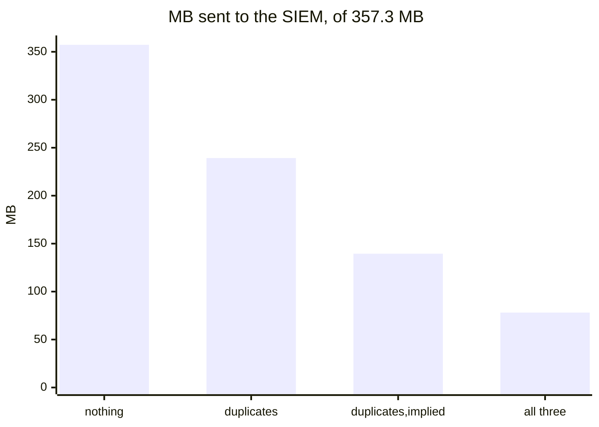

# Sluice

**Sluice reads the rules your SIEM runs and a sample of your data, works out what no rule
needs, and writes the configuration that stops sending it: for Vector, Microsoft Sentinel,
Elasticsearch, Fluent Bit and the OpenTelemetry Collector. Every saving is proven on your own
data, so your rules raise exactly the same alerts. Sluice changes nothing itself: you decide
what runs.**

> **1.0.** Tested on real data and in the real engines. The commands, exit codes and
> `plan.json` stay stable across 1.x ([what stays stable](docs/stability.md)).

## Choose what to save

Sluice has three kinds of saving. `--mode` picks them, and all three run by default:

| `--mode` | What it leaves out | What the SIEM still gets |
|---|---|---|
| **`duplicates`** | Text that repeats the event's own fields (a rendered `Message`, the original line next to its parsed fields, XML that repeats columns) and empty fields | Every event, with every value |
| **`implied`** | Values that follow from the kind of event or from another field, such as `Channel: Security` on every Security event | Every event; a value left out comes back exactly from the plan (`<Table>Full` in Sentinel, runtime fields in Elasticsearch) |
| **`counts`** | Frequent events no rule could match, such as routine LSASS access | A count per minute in their place; the events themselves stay in the archive |

One Windows logon event, with `duplicates` and `implied`:

```diff
 {
   "EventID": 4624,
   "TargetUserName": "alice",
   "IpAddress": "10.0.0.7",
   "LogonType": 3,
-  "Message": "An account was successfully logged on. ... alice ... 10.0.0.7 ...",   duplicates: repeats the fields
-  "WorkstationName": "",                                                             duplicates: empty
-  "Channel": "Security",                                                             implied: every 4624 says so
 }
```

What each choice saves on real attack data, [OTRF](https://github.com/OTRF/Security-Datasets)'s
APT29 emulation (357.3 MB of Windows Security and Sysmon events, eight rules for that attack,
the same 987 alerts every time):



| `--mode` | Saved | Every event arrives? |
|---|---|---|
| `duplicates` | 33.1 % | yes, with every value |
| `duplicates,implied` | 60.9 % | yes; implied values come back from the plan |
| `duplicates,implied,counts` (the default) | 78.1 % | events no rule could match arrive as counts |

```sh
sluice analyze … --mode duplicates           # only what is repeated or empty
sluice analyze … --mode duplicates,implied   # lossless: nothing a query could miss
sluice analyze …                             # all three
```

Whatever you choose, a field a rule reads is kept on every event the rule could match, and the
proof checks the result. `--mode rules` is `duplicates,counts`, as 1.0 named it.

**See a whole report before you install anything:**
[`docs/example-report.html`](docs/example-report.html) is the report for that APT29 data, with
all three modes (download it and open it in a browser; GitHub shows its source). It shows each
saving at work, the 39,278 LSASS accesses counted into 2,489 records while the 5 the
credential-dumping rule could match are sent whole, and per source the events as the SIEM
still receives them. The events are OTRF's, under the MIT license
([credits](docs/credits.md#data-in-the-example-report)).

## How it works

1. **It reads your rules** from the SIEM, with a read-only account.
2. **It sorts a sample of your traffic** into kinds of events.
3. **It proposes savings** of the modes you chose, from community recipes, from what it learns
   in the sample and, if you like, from AI.
4. **It proves** on your sample that your rules raise exactly the same alerts on what would
   still be sent as on everything.
5. **It writes** a report, the savings plan (`plan.json`) and the configurations that carry it
   out. You review them and deploy them with your own tooling.

Sluice never sits in your data path ([ADR 0030](docs/adr/0030-advice-only.md)).

## Safety contract

These rules are enforced in code, and AI output can never override them:

1. Unknown data passes through untouched.
2. A full copy is kept before any saving. `vector.yaml` archives every event, and a Sentinel rule
   gets an untransformed flow into an archive table. An Elasticsearch pipeline or an agent filter
   cannot write a second copy, so keep one where you send the data from.
3. Anything a rule could match is sent in full.
4. Rare events are never saved on.
5. Every saving is proven before it is proposed. `sluice prove` proves a configuration again
   when it changes, and `sluice verify` proves a plan again on later data and the rules of now.
6. AI proposes; the guardrails decide.

When Sluice cannot read part of a rule, it assumes the rule reads everything. That costs savings,
never a detection. The report lists every rule next to what Sluice made of it.

## Status

**Proven against the real product:** Microsoft Sentinel (the guide followed on a live
workspace, its rules run in the Kusto emulator), Elastic Security (Kibana and Elasticsearch
9.1, pipelines proven in Elasticsearch), Wazuh 4.14 (the fetch and `logtest`), Splunk
Enterprise 10.6 (the fetch, and its saved searches run in Splunk for the proof; Sluice writes no
Splunk configuration yet, so `vector.yaml` runs in front of it), and Vector, Fluent Bit and the
OpenTelemetry Collector, whose configurations run in the real engine in every test run.

**Rules read from files**, such as Sigma rules or detection rules kept in Git, are supported.
A file cannot say it holds every rule the SIEM runs, so `counts` needs `--rules-complete` there;
`sluice verify` with fetched rules tells you when the files and the SIEM drift apart.

**Experimental:** Splunk on events it parses with an add-on (such as `XmlWinEventLog`): Sluice
reads JSON events with the fields Splunk extracts from their keys, not an add-on's extractions.

Stuck somewhere? Open an [issue](https://github.com/Dr1nS0menOp/SLUICE/issues).

## 1. Install

Sluice runs on Linux (x86_64 and aarch64), including WSL2 on Windows: one static binary without
dependencies. Each [release](https://github.com/Dr1nS0menOp/SLUICE/releases) has it in three
forms.

**The binary:**

```sh
version=1.0.0
file=sluice-$version-$(uname -m)-unknown-linux-musl
curl -fLO "https://github.com/Dr1nS0menOp/SLUICE/releases/download/v$version/$file"
curl -fLO "https://github.com/Dr1nS0menOp/SLUICE/releases/download/v$version/$file.sha256"
sha256sum --check "$file.sha256"
mkdir -p ~/.local/bin && install -m 0755 "$file" ~/.local/bin/sluice
sluice --version
```

**A package** (`/usr/bin/sluice`):

```sh
curl -fLO https://github.com/Dr1nS0menOp/SLUICE/releases/download/v1.0.0/sluice_1.0.0_amd64.deb
sudo apt install ./sluice_1.0.0_amd64.deb         # Debian, Ubuntu; arm64: _arm64.deb
# sudo dnf install ./sluice-1.0.0-1.x86_64.rpm    # Fedora, RHEL; aarch64: .aarch64.rpm
```

**The container image** (linux/amd64 and linux/arm64, without privileges; Sluice only, not the
engines the proof can use):

```sh
docker run --rm -u "$(id -u)" -v "$PWD:/work" ghcr.io/dr1ns0menop/sluice:1.0.0 demo
```

**Check where it came from.** Every file and the image carry a GitHub attestation of the
workflow and commit that built them, and `sluice-1.0.0.cdx.json` lists what the binary is built
from ([ADR 0040](docs/adr/0040-release-artifacts.md)):

```sh
gh attestation verify "$file" --repo Dr1nS0menOp/SLUICE
gh attestation verify oci://ghcr.io/dr1ns0menop/sluice:1.0.0 --repo Dr1nS0menOp/SLUICE
```

The guides use the repository's scripts and Docker for the engines the proof runs your rules in:
`git clone https://github.com/Dr1nS0menOp/SLUICE.git ~/sluice`. To build from source instead:
`cd ~/sluice && cargo install --locked --path crates/sluice-cli`
([rustup](https://rustup.rs) installs the pinned Rust version on the first build).

## 2. See it work

```sh
sluice demo --scale 100
```

The demo generates an hour of synthetic traffic from a small company network (Windows
Security, Sysmon, Linux auth, a firewall, DNS and nginx, with six planted attacks) and runs
Sluice on it with example Sigma rules:

```
80,536 events from 6 sources, 76 templates
  ingest  121.0 MB → 26.0 MB  (78.5% saved, 41,562 events summarized into 17,161 records)
  modes   duplicates 17.0%, implied 11.0%, counts 50.5%
  proof   41 alerts on full data, 41 on forwarded data  ✓ no detection changed
```

With `--mode duplicates,implied` the same demo saves 66.0 % and sends every event. It writes
into `out/`:

- `report.html`: the advice, for people: one page without scripts, to mail or open offline;
- `plan.json`: the same decisions, for tools ([its schema](docs/plan.schema.json));
- `vector.yaml`: a [Vector](https://vector.dev) 0.59 configuration that carries the plan out;
- `rules.json`: every rule, and what Sluice made of it;
- `samples/` and `sluice.yaml`: the sample and its sources, to run `sluice analyze` on.

## 3. Use it with your SIEM

Each guide in [Sluice with your SIEM](docs/siems.md) takes the same steps: a read-only account,
`sluice rules fetch`, a sample, a description of the sources, `sluice analyze`, and then you
deploy what you want.

| SIEM | Rules read from | The proof runs them in | Sluice also writes |
|---|---|---|---|
| [Microsoft Sentinel](docs/siems.md#microsoft-sentinel-azure) | the workspace (analytics rules, hunting queries, functions) | the Kusto emulator | the data collection rule's `transformKql` |
| [Wazuh](docs/siems.md#wazuh-on-premises) | the manager's rule and decoder files | not run: they bound the savings, and `logtest` spot-checks them | |
| [Elastic Security](docs/siems.md#elastic-security-self-managed-or-elastic-cloud) | Kibana's detection rules | Elasticsearch | an ingest pipeline |
| [Splunk Enterprise](docs/siems.md#splunk-enterprise) | saved searches, macros, `props`, `transforms` | a Splunk of the proof's own | |
| [Any other SIEM](docs/siems.md#any-other-siem-sigma-rules) | Sigma rules | rsigma | |

`vector.yaml` works in front of every one of them.

## 4. Where the savings run

Sluice proves each configuration in the engine it is for before it writes it:

| Where the saving runs | What `sluice analyze` writes | Proven in |
|---|---|---|
| [Vector](https://vector.dev) | `vector.yaml`, always: every saving, counting included | the `vrl` crate Vector embeds; its tests let `vector test` check Vector itself |
| Microsoft Sentinel's ingestion | with `--native sentinel --sentinel-dcr RULE.json`: that data collection rule with a `transformKql` per table and an untransformed flow into an archive table, and `<Table>Full.kql`, which puts implied values back; records Vector would count stay in the archive table only (ADR 0036) | the Kusto emulator |
| Elasticsearch's ingestion | with `--native elastic`: an ingest pipeline per source, and runtime fields that put implied values back | Elasticsearch |
| Fluent Bit | with `--native fluent-bit`: a Lua filter per source | Fluent Bit |
| OpenTelemetry Collector | with `--native otel`: `transform` statements per source | the collector |

Outside Vector, only field removals run: counting needs state across events, which only a
pipeline tool keeps. `plan.json` says for each kind of event where its saving can run.

`vector.yaml` reads files and writes files. Point its sources and sinks at your own, and roll it
out with the tooling you already use (Git, CI, Ansible, Kubernetes). In CI, `sluice prove` proves
the configuration in a pull request as it is. It fails when the configuration would change a
detection, or when the sample raises no alert at all (`action.yml` runs it on GitHub; ADR 0022).

**After it runs.** A plan is proven on one day's sample with that day's rules. `sluice verify`
proves it again on a later sample with the rules the SIEM runs now, and says whether it still
holds ([ADR 0039](docs/adr/0039-sluice-verify.md)):

```sh
sluice rules fetch --out rules-now sentinel --workspace "$WORKSPACE"
sluice verify --analysis out --input samples-today --sources sources.yaml --sentinel-rules rules-now \
  --kusto http://127.0.0.1:8090 --sentinel-table SecurityEvent=SecurityEvent
```

Exit 0: it holds. 1: a detection would change; take the plan out. 3: rules were added or changed
since the plan was proven, so it does not protect them; run `sluice analyze` again. It also
says what the new sample does to the savings: data of a kind the plan does not know is sent whole,
and kinds of event whose saving fell are listed. Run it daily (`--json` for a job) for the
re-verification contract rule 5 asks for.

For data you send to Sentinel yourself, `sluice connect sentinel` writes two kinds of tables
with their data collection rules: a custom table derived from a sample (`--sample`), and a table
for summaries with a function that counts them in (`--summary-table`).

**With an AI assistant.** `sluice mcp` hands an analysis to an assistant (Claude Code, Claude
Desktop, any MCP client) to work out further, and proves what it drafts first: a changed
`vector.yaml` through `prove_vector`, a data collection rule's `transformKql` in the Kusto
emulator through `prove_transform_kql`. Every tool only reads or proves; a person deploys
([ADR 0035](docs/adr/0035-mcp-for-assistants.md)):

```sh
claude mcp add sluice -- sluice mcp --out out --input samples --sources sources.yaml --rules sigma-rules
```

## Building and testing

Sluice is a Rust workspace; the toolchain is pinned in `rust-toolchain.toml`.

```sh
cargo build --release
bash scripts/check.sh        # every quality gate; with Docker also the real engines
bash scripts/install-zig.sh && bash scripts/build-release.sh   # static binaries for both architectures
bash scripts/install-packaging.sh && bash scripts/package.sh  # .deb, .rpm, the image's context, the SBOM
```

On Windows, run the same commands in WSL2. macOS is not supported: use a Linux VM or container
([ADR 0003](docs/adr/0003-linux-only.md)).

## Documentation

- [Sluice with your SIEM](docs/siems.md): a guide per SIEM, from a read-only account to the
  configuration to deploy
- [Using Sluice](docs/usage.md): step by step, from a first look to the configurations for your
  SIEM and your tools
- [User guide](docs/guide.md): concepts, source descriptions, every command and what it writes
- [Architecture and technologies](docs/architecture.md): diagrams of the analysis and of what
  each configuration does, one event followed step by step, the parts, and what each is built on
- [Glossary](docs/glossary.md): the terms Sluice uses
- [How Sluice saves](docs/how-sluice-saves.md): the algorithm, step by step and each way of
  saving in depth
- [Testing Sluice on your own SIEM](docs/field-test.md): a field test step by step, with a
  baseline, a second day to prove on, the way back, and what to report
- [Field theory](docs/notes/field-theory.md): why a byte may go, what keeps every event's value,
  and the measurements behind both
- [What stays stable](docs/stability.md): what 1.x keeps, and the JSON Schema of `plan.json`
- [Architecture decisions](docs/adr/)
- [Compatibility](docs/compatibility.md)
- [Credits](docs/credits.md): the people and research Sluice builds on
- [Contributing](CONTRIBUTING.md)
- [Changelog](CHANGELOG.md)
- [Security policy](SECURITY.md)

## License

Sluice is licensed under the [GNU Affero General Public License v3.0 only](LICENSE)
(AGPL-3.0-only). You may use, modify and sell it, but if you distribute a modified version or
offer it to others over a network, you must publish its complete source under the same license.
[ADR 0008](docs/adr/0008-license.md) explains the choice.
