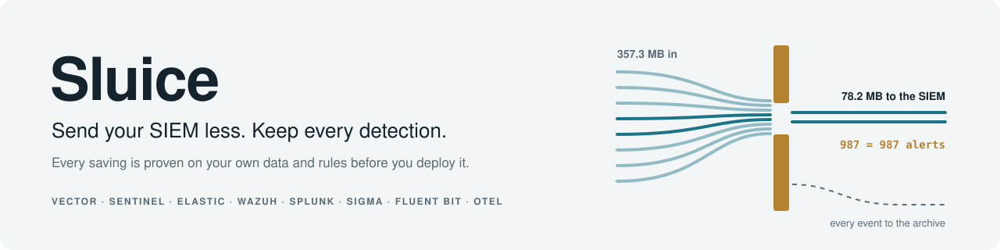
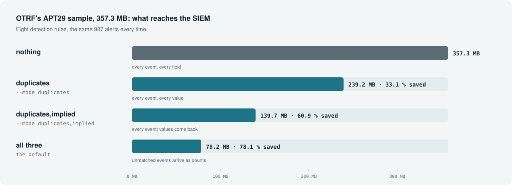
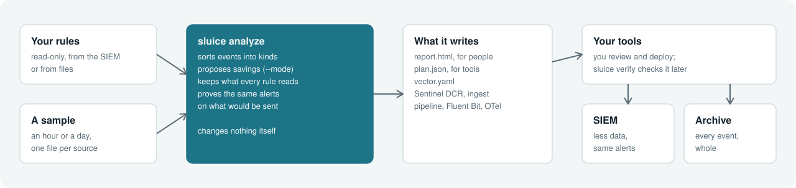

<p align="center">
  <picture>
    <source media="(prefers-color-scheme: dark)" srcset="docs/images/hero-dark.svg">
    
  </picture>
</p>

<p align="center">
  <a href="#quick-start"><b>Quick start</b></a> ·
  <a href="#choose-what-to-save">Choose what to save</a> ·
  <a href="docs/siems.md">Your SIEM</a> ·
  <a href="docs/example-report.html">Example report</a> ·
  <a href="docs/usage.md">Docs</a>
</p>

Sluice reads the rules your SIEM runs and a sample of your data, and works out what no rule
needs. It writes the configuration that stops sending that data, for Vector, Microsoft Sentinel,
Elasticsearch, Fluent Bit and the OpenTelemetry Collector. Every saving is **proven on your own
data**: your rules raise exactly the same alerts. Sluice changes nothing itself, and you decide
what runs.

> **1.0** · Linux and WSL2 · AGPL-3.0 · The commands, exit codes and `plan.json` stay stable
> across 1.x ([what stays stable](docs/stability.md)).

## Choose what to save

Three kinds of saving, picked with `--mode`. All three run by default.

| `--mode` | Leaves out | The SIEM still gets |
|---|---|---|
| **`duplicates`** | Text that repeats the event's own fields (a rendered `Message`, the original line next to its parsed fields), and empty fields | every event, with every value |
| **`implied`** | Values the kind of event already says, such as `Channel: Security` on every Security event | every event; a value left out comes back exactly from the plan |
| **`counts`** | Frequent events no rule could match, such as routine LSASS access | a count per minute in their place; the events stay in the archive |

One Windows logon, with `duplicates` and `implied`:

```diff
 {
   "EventID": 4624,
   "TargetUserName": "alice",
   "IpAddress": "10.0.0.7",
   "LogonType": 3,
-  "Message": "An account was successfully logged on. ... alice ... 10.0.0.7 ...",   duplicates: repeats the fields
-  "WorkstationName": "",                                                             duplicates: empty
-  "Channel": "Security",                                                             implied: every 4624 says so
 }
```

<picture>
  <source media="(prefers-color-scheme: dark)" srcset="docs/images/modes-dark.svg">
  
</picture>

```sh
sluice analyze … --mode duplicates           # only what is repeated or empty
sluice analyze … --mode duplicates,implied   # lossless: every event arrives
sluice analyze …                             # all three
```

Whatever you choose, a field a rule reads is kept on every event the rule could match, and the
proof checks the result. The figures are from [OTRF](https://github.com/OTRF/Security-Datasets)'s
APT29 emulation, with eight rules written for that attack; its
[full report](docs/example-report.html) shows each saving at work (download it and open it in a
browser).

## Quick start

```sh
# 1. Install: one static binary (packages and a container image below)
curl -fLO https://github.com/Dr1nS0menOp/SLUICE/releases/download/v1.1.0/sluice-1.1.0-$(uname -m)-unknown-linux-musl
mkdir -p ~/.local/bin && install -m 0755 sluice-1.1.0-$(uname -m)-unknown-linux-musl ~/.local/bin/sluice

# 2. See it work on an hour of synthetic traffic with six planted attacks
sluice demo --scale 100

# 3. Your own data: describe the sample, then analyze it with your rules
sluice init --input samples/                  # proposes sources.yaml: check it
sluice analyze --input samples/ --sources sources.yaml --rules sigma/ --rules-complete
```

The demo prints:

```
80,536 events from 6 sources, 76 templates
  ingest  121.0 MB → 23.5 MB  (80.6% saved, 48,697 events summarized into 19,856 records)
  modes   duplicates 17.0%, implied 10.7%, counts 52.9%
  proof   45 alerts on full data, 45 on forwarded data  ✓ no detection changed
```

It writes into `out/`: `report.html` (the advice, for people), `plan.json` (the same, for tools;
[its schema](docs/plan.schema.json)), `vector.yaml` (a [Vector](https://vector.dev) 0.59
configuration that carries it out) and `rules.json` (every rule, and what Sluice made of it).

## How it works

<picture>
  <source media="(prefers-color-scheme: dark)" srcset="docs/images/flow-dark.svg">
  
</picture>

- **It reads your rules** from the SIEM with a read-only account, or from files.
- **It sorts your sample into kinds of event**, and reads text lines the way your SIEM does when
  a source names its [parser pack](docs/guide.md#text-lines-and-parser-packs) (nginx, Apache,
  Squid, firewalls, DNS, the Linux auth log, …).
- **It proposes savings** of the modes you chose: from community recipes, from values it learns
  on every machine of the sample, and, if you like, from AI.
- **It proves** that your rules raise exactly the same alerts on what would still be sent as on
  everything, and rolls back what does not.
- **It writes** the plan and the configurations. `sluice prove` checks a configuration again in
  CI, and `sluice verify` checks a plan again on later data and the rules of now.

Sluice never sits in your data path ([ADR 0030](docs/adr/0030-advice-only.md)).

## Safety contract

Enforced in code; AI output can never override it.

1. Unknown data passes through untouched.
2. A full copy is kept before any saving: `vector.yaml` archives every event, and a Sentinel rule
   gets an untransformed flow into an archive table. An Elasticsearch pipeline or an agent filter
   cannot write a second copy, so keep one where you send the data from.
3. Anything a rule could match is sent in full.
4. Rare events are never saved on.
5. Every saving is proven before it is proposed, and again with `sluice prove` and
   `sluice verify`.
6. AI proposes; the guardrails decide.

When Sluice cannot read part of a rule, it assumes the rule reads everything. That costs savings,
never a detection.

## Use it with your SIEM

Each [guide](docs/siems.md) takes the same steps: a read-only account, `sluice rules fetch`, a
sample, `sluice init`, `sluice analyze`, and then you deploy what you want.

| SIEM | Rules read from | The proof runs them in | Sluice also writes |
|---|---|---|---|
| [Microsoft Sentinel](docs/siems.md#microsoft-sentinel-azure) | the workspace: analytics rules, hunting queries, functions | the Kusto emulator | the data collection rule's `transformKql` |
| [Elastic Security](docs/siems.md#elastic-security-self-managed-or-elastic-cloud) | Kibana's detection rules | Elasticsearch | an ingest pipeline |
| [Wazuh](docs/siems.md#wazuh-on-premises) | the manager's rule and decoder files | not run: they bound the savings, `logtest` spot-checks | |
| [Splunk Enterprise](docs/siems.md#splunk-enterprise) | saved searches, macros, `props`, `transforms` | a Splunk of the proof's own | |
| [Any other SIEM](docs/siems.md#any-other-siem-sigma-rules) | Sigma rules | rsigma | |

`vector.yaml` works in front of every one of them. Fluent Bit and the OpenTelemetry Collector get
their own filters with `--native` ([where the savings run](docs/usage.md#3-carry-out-the-savings)).

**After it runs.** `sluice verify` proves a plan again on a later sample with the rules your SIEM
runs now: exit 0 when it holds, 1 when a detection would change, 3 when rules were added since
([ADR 0039](docs/adr/0039-sluice-verify.md)). Run it daily.

**With an AI assistant.** `sluice mcp` hands an analysis to Claude Code or any MCP client, and
proves what the assistant drafts before a person deploys it ([ADR 0035](docs/adr/0035-mcp-for-assistants.md)).

## Status

**Proven against the real product:** Microsoft Sentinel (the guide followed on a live workspace),
Elastic Security 9.1, Wazuh 4.14 and Splunk Enterprise 10.6; Vector, Fluent Bit and the
OpenTelemetry Collector run every configuration in every test run. Rules read from files, such as
Sigma rules or detection rules kept in Git, are supported; `counts` needs `--rules-complete`
there.

**Experimental:** Splunk events it parses with an add-on (such as `XmlWinEventLog`).

Stuck somewhere? Open an [issue](https://github.com/Dr1nS0menOp/SLUICE/issues).

## Install

Linux (x86_64 and aarch64), including WSL2 on Windows. Each
[release](https://github.com/Dr1nS0menOp/SLUICE/releases) has three forms of the same static
binary:

```sh
# The binary, with its SHA-256 sum
version=1.1.0 file=sluice-1.1.0-$(uname -m)-unknown-linux-musl
curl -fLO "https://github.com/Dr1nS0menOp/SLUICE/releases/download/v$version/$file"
curl -fLO "https://github.com/Dr1nS0menOp/SLUICE/releases/download/v$version/$file.sha256"
sha256sum --check "$file.sha256" && mkdir -p ~/.local/bin && install -m 0755 "$file" ~/.local/bin/sluice

# A package, in /usr/bin/sluice
sudo apt install ./sluice_1.1.0_amd64.deb        # Debian, Ubuntu (arm64: _arm64.deb)
sudo dnf install ./sluice-1.1.0-1.x86_64.rpm     # Fedora, RHEL (aarch64: .aarch64.rpm)

# The container image, linux/amd64 and arm64, without privileges
docker run --rm -u "$(id -u)" -v "$PWD:/work" ghcr.io/dr1ns0menop/sluice:1.1.0 demo
```

Every file and the image carry a GitHub attestation of the workflow and commit that built them,
and `sluice-1.1.0.cdx.json` lists what the binary is built from
([ADR 0040](docs/adr/0040-release-artifacts.md)):

```sh
gh attestation verify "$file" --repo Dr1nS0menOp/SLUICE
```

The guides use the repository's scripts and Docker for the engines the proof runs your rules in
(`git clone https://github.com/Dr1nS0menOp/SLUICE.git`). To build from source:
`cargo install --locked --path crates/sluice-cli`; [rustup](https://rustup.rs) installs the
pinned Rust version.

## Documentation

| | |
|---|---|
| [Sluice with your SIEM](docs/siems.md) | a guide per SIEM, from a read-only account to the configuration to deploy |
| [Using Sluice](docs/usage.md) | step by step, from a first look to the configurations for your tools |
| [User guide](docs/guide.md) | sources, parser packs, modes, every command and what it writes |
| [How Sluice saves](docs/how-sluice-saves.md) | the algorithm, step by step and each way of saving in depth |
| [Architecture](docs/architecture.md) | the analysis, one event followed step by step, the parts, and what is still weak |
| [Testing on your own SIEM](docs/field-test.md) | a field test with a baseline, a second day to prove on, and the way back |
| [What stays stable](docs/stability.md) | what 1.x keeps, and the JSON Schema of `plan.json` |
| [Glossary](docs/glossary.md) · [Decisions](docs/adr/) · [Compatibility](docs/compatibility.md) | the terms, the ADRs, the engine versions |
| [Contributing](CONTRIBUTING.md) · [Changelog](CHANGELOG.md) · [Security](SECURITY.md) · [Credits](docs/credits.md) | |

**Building and testing.** A Rust workspace with the toolchain pinned in `rust-toolchain.toml`:
`cargo build --release`, and `bash scripts/check.sh` for every quality gate (with Docker also the
real engines). On Windows, run them in WSL2 ([ADR 0003](docs/adr/0003-linux-only.md)).
`python3 scripts/readme-images.py` draws the images above.

## License

[GNU Affero General Public License v3.0 only](LICENSE). You may use, modify and sell Sluice, but
if you distribute a modified version or offer it to others over a network, you must publish its
complete source under the same license ([ADR 0008](docs/adr/0008-license.md)).
