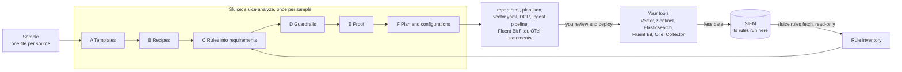
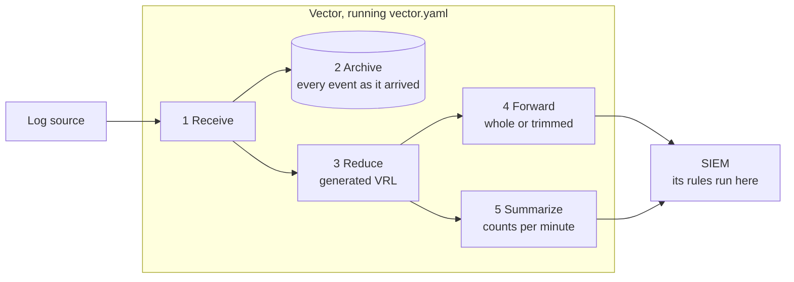

# How Sluice works, and what it is built on

This page is for people who want to understand Sluice before they run it, review it or
contribute to it. It follows an event through the analysis and through the configurations Sluice
writes, says which technology does each step, and lists where the model is still weak. The
decisions behind each choice are in [the ADRs](adr/); verified facts about third-party tools are
in [the notes](notes/).

## The idea in one picture

Sluice looks at the rules your SIEM runs and a sample of your data, decides where you can send
less, proves every decision, and writes it down as configuration for the tools that move your
data. It never sits in the data path: your own Vector, Sentinel's ingestion, Elasticsearch,
Fluent Bit or OpenTelemetry Collector carries the savings out, and you decide what runs
([ADR 0030](adr/0030-advice-only.md)).

The letters are the steps of an analysis. The numbers further down are the steps every event
takes in Vector. The terms are explained in the [glossary](glossary.md).

## The inputs: rules and a sample

- **Rules.** `sluice rules fetch` reads what a SIEM runs, read-only, into a directory with an
  `inventory.json` that marks it complete (ADR 0021): a Sentinel workspace's analytics rules,
  hunting queries, functions and query log; a Wazuh manager's rule and decoder files; the
  detection rules of a Kibana space; Splunk's saved searches, macros, props and transforms.
  Sigma rules come from a directory, and the operator says whether they are complete.
- **A sample.** One NDJSON file per source, an hour or a day of it, and a sources file that
  describes each source: its Sigma log source, its format (JSON or text) and the field naming
  convention of its records (`schema`).

## The analysis: how Sluice decides

`sluice analyze` takes these steps once, on the sample. `sluice demo` does the same on
synthetic data.

- **A. Templates.** Events are grouped into *templates*, one kind of event in one source. For
  JSON: the values of the fields that name the kind of event (`EventID`, `event.code`,
  `event.action`, `action`, defaults for products such as CloudTrail, and the source's own
  `event_type`), with each frequent set of field paths accepted and each rare one a template of
  its own (without event-type values, one template per exact set). For text: a Drain cluster
  of the line, with the syslog header reduced to the program name and numbers and hex
  identifiers masked, split where only a few words alternate, so `Accepted` and `Failed` stay
  apart (ADR 0019). A template is the unit recipes target, the guardrails reason about and the
  rarity floor counts.
- **B. Recipes.** Community recipes (YAML in [`recipes/`](../recipes/)), the operator's own and,
  optionally, an AI advisor propose reductions per template: drop fields or empty fields (L1),
  forward what rules could match and summarize the rest (L2), or summarize a template no rule
  covers (L3). A proposal is never trusted.
- **C. Rules into requirements.** Every loaded rule is read into the same engine-neutral
  *requirements*: the log source it applies to, the fields it reads (including those in
  exclusions), whether it matches raw text, whether it counts or correlates events, and a
  *pre-filter*: a superset of the events it could match. Sigma rules are read with rsigma, Wazuh
  `rules.xml` with quick-xml (bounded by decoders), Microsoft Sentinel analytics rules with
  Sluice's own KQL reader (ASIM parsers included), Elastic's KQL and EQL with Sluice's own
  parsers (ES|QL and Lucene read broadly), and Splunk's searches by their base search, with
  macros expanded. Anything not understood widens to "may read everything, on every event".
- **D. Guardrails.** The safety contract turns each proposal into an *effective recipe*: unknown
  data and rare templates (fewer than 100 events, or under 0.1 % of their source) are never cut,
  nothing is cut without the archive, a field a rule may read is kept on every event the rule
  could match, and events a rule could match are forwarded whole. A rule whose field names
  follow another convention than the source's is read as reading everything (ADR 0018). Without
  a complete rule inventory, nothing is summarized (ADR 0021). Every refusal is recorded with
  the contract rule behind it.
- **E. Proof.** The rules run twice on the sample, on the full events and on the events as the
  reductions would forward them, computed with the same VRL Vector runs (the `vrl` crate). Only
  the same alerts in both directions count as proof; a recipe implicated in a difference is
  rolled back and the proof runs again. Sigma rules run in rsigma. Sentinel analytics rules run
  in the Kusto emulator when `--kusto` is given, where each result row counts as an alert, and
  Elastic's rules in Elasticsearch when `--elasticsearch` is given. Wazuh rules are not
  evaluated in the proof: they constrain the guardrails, and `--wazuh-api` can spot-check
  reductions with a Wazuh manager's `logtest`. Splunk's searches constrain the guardrails only.
- **F. Plan and configurations.** Sluice writes the report, the savings plan (`plan.json`, ADR
  0023) and the configurations built from the same proven selection: always a `vector.yaml`,
  and on request a configuration in a tool's own language, each run in that tool on the sample
  before it is written.

## What the configurations do

### In Vector: every event, every saving

1. **Receive.** A Vector source takes the events in. The generated file reads the sample files,
   one JSON event per line; in your deployment, your own sources take their place.
2. **Archive.** Every event goes to the archive sink as it arrived, a file per source and hour.
   Whatever the reductions do, the original is kept (safety contract rule 2).
3. **Reduce.** The VRL program Sluice generated recognises each event's template and picks its
   route: `forward` or `summarize`. On forwarded events it removes the fields the recipe may
   remove, except on events a protecting rule could match, which stay whole. An event the program
   fails on is forwarded unchanged, and so is an event that fits no template.
4. **Forward.** Forwarded events go to the forward sink, whole or trimmed. The generated file
   writes them to a file; in your deployment, your SIEM's Vector sink takes its place
   (`azure_logs_ingestion`, `splunk_hec_logs`, `elasticsearch`, and so on).
5. **Summarize.** Summarized events become counts: a Vector `reduce` transform emits one record
   per template and per combination of the recipe's summary keys every 60 seconds
   (`sluice_summary`, `sluice_template`, `sluice_keys`, `sluice_count`). Rules never see
   summaries; the originals are in the archive.

### In a SIEM's ingestion or an agent: field removals

A data collection rule, an ingest pipeline, a Fluent Bit filter and the collector's `transform`
processor see one record at a time, so they can remove fields (L1) but not count. Each recognises
a record's template, keeps whole every record a rule could match (by a condition that matches at
least what the VRL matches), and leaves a record that fits no template unchanged. Text templates
and counting stay with a pipeline tool; `runs_in` in the plan says per saving where it can run.

| Target | What Sluice writes | Proven in |
|---|---|---|
| Microsoft Sentinel (ADR 0013) | The data collection rule with a `transformKql` per table, and an untransformed flow of the same stream into an Auxiliary archive table | the Kusto emulator |
| Elasticsearch (ADR 0024) | An ingest pipeline per source: one Painless `script` processor | Elasticsearch, through `_ingest/pipeline/_simulate` |
| Fluent Bit (ADR 0027) | A Lua filter per source | Fluent Bit |
| OpenTelemetry Collector (ADR 0028) | OTTL statements per source in a `transform` processor | the collector |

## An example: one Windows firewall event, step by step

Windows logs event 5156 each time its filtering platform permits a connection. With that audit
on, it is usually the busiest event in the Security log. Follow one of them, as `sluice demo`
generates it (event data as top-level fields), from host `web01` to a SIEM that stores the
fields as they arrive. Besides SigmaHQ, one example rule is loaded: *LSASS opens a network
connection* (`EventID: 5156`, `Application|endswith: '\lsass.exe'`).

| Step | What happens to this event |
|---|---|
| A Templates | `EventID` is 5156, so the event belongs to template `windows-security:5156:<hash>`, which holds every frequent shape of 5156. It is far above the rarity floor of 100 events and 0.1 % of the source. |
| B Recipes | Two community recipes match and are merged: `microsoft/windows/security/rendered-message` (drop `Message` and empty fields, L1) and `microsoft/windows/security/filtering-platform-connection` (forward what a rule could match, count the rest per `Application`, `DestAddress`, `DestPort`, `Protocol`, L2). |
| C Rules | The example rule applies to `windows/security`, reads `EventID` and `Application`, and can only match events with `EventID` 5156 whose `Application` ends in `\lsass.exe`: its pre-filter. |
| D Guardrails | Events the pre-filter matches are forwarded whole; every other 5156 event is counted. The records follow Sigma's names (`schema: sigma`), so the rule's fields can be compared with them. |
| E Proof | The rules run on the sample twice, on full events and on what the generated VRL would forward. The example rule fires on the same `lsass.exe` events both times, so the recipe holds. |
| F Output | `vector.yaml` gets the template's classifier, route and summary. The plan says the field removals could also run in a data collection rule, an ingest pipeline or an agent, and the counting only in a pipeline tool. |
| 1 Receive | In your Vector, the JSON arrives: `EventID 5156`, `Application …\svchost.exe`, `DestAddress 10.0.0.53`, `DestPort 53`, `Protocol 17`, a rendered `Message`, and so on. |
| 2 Archive | A full copy goes to the archive sink before anything changes. |
| 3 Reduce | The program classifies the event as the 5156 template. Its `Application` is `svchost.exe`, outside the pre-filter, so its route is `summarize`. An `lsass.exe` event would be forwarded unchanged. |
| 5 Summarize | Instead of the event, the SIEM receives one record per minute per key combination, such as `{"sluice_template": "windows-security:5156:…", "sluice_keys": {"Application": "…\svchost.exe", "DestAddress": "10.0.0.53", "DestPort": "53", "Protocol": 17}, "sluice_count": 1840}`. |
| SIEM | The rule runs on the forwarded `lsass.exe` events as before. The single event is in the archive. |

Read from Microsoft Sentinel's `SecurityEvent` table instead (`--sentinel-table
windows-security=SecurityEvent`), three things differ. `Application`, `DestAddress`, `DestPort`
and `Protocol` have no column there and live only in the `EventData` XML. Sentinel's KQL
analytics rules are read and run in the Kusto emulator; Sluice bounds a KQL rule by `EventID` and
a few fixed columns only, so if one reads 5156, every 5156 event is forwarded. And if none does,
the summary keys above are read from the `EventData` XML (ADR 0020), so the summary records keep
their keys. A data collection rule cannot count, so in Sentinel's own ingestion only the field
removals run; counting the 5156 bulk needs Vector in front of Sentinel.

## Review: `sluice prove`

`sluice prove` closes the loop for review (ADR 0022). It reads the programs back out of a Vector
configuration, as it stands in a pull request, and proves them on a sample: the rules must raise
the same alerts on what it forwards as on everything, and the sample must raise at least one
(unless `--allow-no-alerts`). It refuses wiring around Sluice's programs that it cannot model,
such as a filter in front of them; sources and sinks are the operator's. The GitHub Action
(`action.yml`) runs it in CI.

## Where the model is weak today

A review on 2026-10-11 (PLAN.md, "Review 2026-10-11"; synthetic `sluice analyze` runs) found gaps
that M9 and M10 addressed. What remains:

- **Field names are mapped only by the pipeline you give.** A Sigma rule names `Image`; Elastic
  stores `process.executable` (ECS). Found on 2026-10-11, such a rule looked as if it read nothing
  of ECS records, and its matches were summarized while the proof passed on two empty alert
  sets. Since ADR 0018 a source declares its convention (`schema`), and since ADR 0020 a pySigma
  processing pipeline maps the rules onto it (`--sigma-pipeline ecs=ecs_windows`). Without one,
  the rule is read as reading everything, which keeps the data and costs the savings. A wrong
  `schema` or a pipeline other than the SIEM's is unsafe, and the proof cannot notice.
- **Text lines are not parsed.** A SIEM parses fields out of a text line before its rules run;
  Sluice does not know that parser. A Sigma rule that tests named fields therefore keeps every
  line of its log source whole (ADR 0020). Parser packs and checked AI-proposed parsers would
  let such sources be cut (M12).
- **Templates still follow shapes in part.** Since ADR 0019, Drain clusters split where a few
  words alternate (sshd's "Accepted" and "Failed"), message ids keep their digits, and JSON
  sources name their event-type fields and share a template per kind of event across their
  frequent shapes. A rare text line that differs only at a parameter position still shares its
  template.
- **Not every SIEM's rules are read.** `sluice rules fetch` reads Sentinel, Wazuh, Elastic
  Security and Splunk (ADR 0021, ADR 0025, ADR 0026); no engine runs Splunk's searches in the
  proof yet. Google SecOps YARA-L, QRadar and workbook queries are not read: for those, the
  completeness of the rules is the operator's claim, and without it Sluice makes lossless cuts
  only.
- **Nothing watches what runs.** Sluice proves a configuration before you deploy it, and
  `sluice prove` again when it changes; it does not see your traffic afterwards. A format that
  changes fits no template and passes through unchanged, which costs savings, not detections.
  A rule added in the SIEM, however, is protected only from the next fetch and analysis on
  (ADR 0030).

## The parts

Sluice is a Rust workspace with one crate per responsibility. Dependencies point inward, toward
`sluice-core`, which has no I/O and no third-party engines.

| Crate | Responsibility |
|---|---|
| `sluice-core` | The domain model, the safety contract, the guardrails and the shadow proof. Pure logic. |
| `sluice-discover` | Template discovery: key sets for JSON, Drain for text. |
| `sluice-rules` | Reads Sigma, Wazuh, Sentinel, Elastic and Splunk rules into requirements; evaluates Sigma for the proof. |
| `sluice-vector` | Compiles recipes to VRL and Vector configuration, runs that VRL for the proof, and derives Sentinel tables and their data collection rules. |
| `sluice-kql` | KQL for Sentinel: reductions as DCR transformations, and analytics rules run in the Kusto emulator for the proof. |
| `sluice-elastic` | Reductions as Elasticsearch ingest pipelines, and Elastic's rules run in Elasticsearch for the proof. |
| `sluice-fluentbit` | Reductions as Fluent Bit Lua filters, and a real Fluent Bit to prove them in. |
| `sluice-otel` | Reductions as OpenTelemetry Collector `transform` statements, and a real collector to prove them in. |
| `sluice-autopilot` | Puts it together: discover, resolve recipes, guard, prove, emit the data plane, the savings plan and the report. |
| `sluice-ai` | The optional AI advisor for recipes. |
| `sluice-wazuh` | Spot checks through a Wazuh manager's `logtest` API, and its rule and decoder files (`sluice rules fetch wazuh`). |
| `sluice-sentinel` | A Sentinel workspace's analytics rules, hunting queries, functions and query log, read-only (`sluice rules fetch sentinel`). |
| `sluice-splunk` | Splunk's saved searches, macros, props and transforms over its REST API, read-only (`sluice rules fetch splunk`). |
| `sluice-synth` | Deterministic synthetic security logs for the demo and the tests. |
| `sluice-cli` | The `sluice` command: arguments, files, exit codes, logging. |

The crates of the archived live part (`sluice-server`, `sluice-archive`, `sluice-mcp`) are in
[`archive/`](../archive/), outside the workspace (ADR 0030).

## Technologies

### Language and build

| Technology | What Sluice uses it for | Why |
|---|---|---|
| [Rust](https://www.rust-lang.org) 1.99 (edition 2024) | All of Sluice | The proof can run the very VRL that Vector enforces, through the `vrl` crate, in the same process; one static binary; no unsafe code (ADR 0001). |
| [Cargo](https://doc.rust-lang.org/cargo/) workspace | One crate per responsibility | Keeps third-party engines behind Sluice's own traits, so young dependencies stay replaceable. |
| musl + [cargo-zigbuild](https://github.com/rust-cross/cargo-zigbuild) | Static release binaries for x86_64 and aarch64 | Run on any Linux distribution without a matching libc (ADR 0007). |
| [cargo-deny](https://github.com/EmbarkStudios/cargo-deny) | License and advisory checks on every dependency | Part of the quality gates. |

### Vector

| Technology | What Sluice uses it for | Why |
|---|---|---|
| [Vector](https://vector.dev) 0.59 (MPL-2.0) | Running `vector.yaml`: receiving, archiving, reducing, summarizing and sending every event (steps 1 to 5) | Fast, widely used, with sinks for every major SIEM, and its transform language is embeddable. |
| [VRL](https://vector.dev/docs/reference/vrl/) through the `vrl` crate 0.36.0 | The reductions Sluice generates (step 3), and running them in the proof (step E) | The same compiler and runtime as Vector 0.59, so what Sluice proves is what Vector runs ([compatibility](compatibility.md)). Generated VRL must compile without warnings. |
| Vector's `reduce` transform | Summaries: counts per template and summary keys per minute (step 5) | Stateful, so it stays a Vector transform; generated `vector test` cases check the routing that feeds it. |

### Rules and engines

| Technology | What Sluice uses it for | Why |
|---|---|---|
| [Sigma](https://sigmahq.io) rules, via [rsigma](https://crates.io/crates/rsigma-parser) 0.24 | Reading Sigma rules into requirements and evaluating them, correlations included, in the proof (steps C and E) | Sigma is the shared rule language most SIEMs can import. Pinned and kept behind Sluice's own trait. |
| Wazuh `rules.xml` and decoders, via quick-xml | Reading Wazuh's own rules into requirements (step C) | Wazuh users keep their real detections; `sluice analyze` can confirm reductions with a manager's `logtest`. |
| Microsoft Sentinel analytics rules (KQL) | Reading the rules a Sentinel workspace runs, ASIM parsers included, into requirements (step C) | Sentinel's detections are KQL, not Sigma (ADR 0015). |
| [Kusto emulator](https://learn.microsoft.com/azure/data-explorer/kusto-emulator-overview) (Docker) | Running Sentinel's analytics rules themselves on full and forwarded records (step E, with `--kusto`), and the generated DCR transformations | The proof for Sentinel is decided by Microsoft's engine and Microsoft's rules. |
| Elastic Security detection rules (KQL, EQL, ES\|QL) and Elasticsearch | Reading Elastic's rules into requirements (step C), and running them and the generated ingest pipelines in Elasticsearch (step E, with `--elasticsearch`) | Elastic's detections are its own languages (ADR 0025). |
| Splunk saved searches (SPL) | Reading scheduled and correlation searches, with their macros, into requirements (step C) | Splunk's detections are SPL (ADR 0026). |
| Drain (implemented in Sluice) | Template discovery for text logs (step A) | A well-studied online log parser; small enough to own ([notes](notes/drain.md)). |

### Configurations Sluice writes

| Technology | What Sluice uses it for |
|---|---|
| Azure Monitor data collection rules | Microsoft Sentinel tables: custom `_CL` tables derived from a sample, the rules of standard tables and of the summary table (`sluice connect sentinel`), and DCR transformations that make the plan's field removals (`--sentinel-native`). Verified in a real workspace ([notes](notes/sentinel-dcr.md)). |
| Elasticsearch ingest pipelines (Painless) | The plan's field removals in Elastic's own ingestion, without Vector ([ADR 0024](adr/0024-elastic-ingest-pipelines.md), [notes](notes/elasticsearch.md)). |
| Fluent Bit Lua filters | The plan's field removals in the agent ([ADR 0027](adr/0027-fluent-bit-lua-filters.md), [notes](notes/fluent-bit.md)). |
| OpenTelemetry Collector `transform` statements (OTTL) | The plan's field removals in the collector ([ADR 0028](adr/0028-otel-transform-statements.md), [notes](notes/otel-collector.md)). |
| GitHub Actions | `action.yml` runs `sluice prove` on a pull request (ADR 0022). |

### AI (optional)

| Technology | What Sluice uses it for |
|---|---|
| Anthropic Claude, or any OpenAI-compatible API (Ollama, LM Studio) | Proposing recipes for frequent templates no community recipe covers (step B). Samples are redacted first, the answer must fit a narrow schema, and the guardrails and the proof decide as for any other recipe. AI proposes; it never decides ([notes](notes/ai.md)). |

## How Sluice checks itself

Every engine Sluice generates code for gets a test against the real engine:

- **Vector:** `scripts/vector-check.sh` runs `vector validate` and `vector test` on a generated
  configuration, so the real binary must reproduce what the `vrl` crate computed.
- **Kusto:** `scripts/kql-check.sh` runs generated KQL and Sentinel rules in the Kusto emulator.
- **Elasticsearch, Fluent Bit, OpenTelemetry Collector:** `scripts/elastic-check.sh`,
  `scripts/fluentbit-check.sh` and `scripts/otel-check.sh` run the generated pipelines, filters
  and statements in the real engine, against what Vector does on the same records.
- **Sigma:** a differential test of the requirements against pySigma over all SigmaHQ rules.
- **Wazuh:** findings checked with a live manager's `logtest` ([notes](notes/wazuh.md)).
- **Azure:** generated tables, data collection rules and transformations checked in a real
  workspace.

Property tests cover the central claim: for all inputs, the alerts over the forwarded data equal
the alerts over the full data. `scripts/check.sh` runs every gate; CI runs the same.
