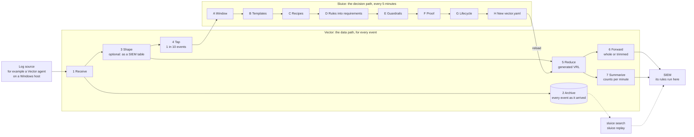

# How Sluice works, and what it is built on

This page is for people who want to understand Sluice before they run it, review it or
contribute to it. It follows an event through the moving parts, says which technology does each
step, and lists where the model is still weak. The decisions behind each choice are in
[the ADRs](adr/); verified facts about third-party tools are in [the notes](notes/).

## The idea in one picture

Sluice sits between your log sources and your SIEM. [Vector](https://vector.dev) moves the data,
event by event. Sluice decides what Vector does with it, proves every decision before it takes
effect, and writes it down as Vector configuration. Sluice does not run your pipelines for you
on other hosts: its product is the configuration and the proof ([ADR 0017](adr/0017-remote-data-plane.md)).

The numbers are steps every event takes in Vector. The letters are steps Sluice takes once per
cycle, on a sample. The terms are explained in the [glossary](glossary.md).

## The data path: what Vector does with every event

Each box names, in monospace, the software that does the step. A dashed red box is a known limit
that the plan addresses.

1. **Receive.** A Vector source takes the events in: `http_server` (for example from the Vector
   agent that `sluice agent windows` configures), syslog, files, or any other Vector source.
2. **Archive.** Before anything else touches it, every event is written to a gzip NDJSON archive,
   per source and UTC hour (`<archive_dir>/<source>/<YYYY-MM-DD>/<HH>.ndjson.gz`). Whatever
   Sluice decides later, the original is kept (safety contract rule 2). `sluice search` and
   `sluice replay` read it back.
3. **Shape (optional).** A source with `shape:` turns its events into the record a SIEM table
   stores, such as Microsoft Sentinel's `SecurityEvent`, `WindowsEvent`, `Syslog`,
   `CommonSecurityLog` or the ASIM tables. This is VRL that Sluice ships. Everything after this
   step works on the shaped record, so Sluice proves on what the SIEM will store.
4. **Tap.** A copy of one in `tap_rate` events (default 10) goes to the control plane over HTTP
   (`POST /tap/<source>`), behind the control token when one is set.
5. **Reduce.** The VRL program Sluice generated recognises each event's template and picks its
   route: `forward` or `summarize`. On forwarded events it removes the fields the recipe may
   remove, except on events a protecting rule could match, which stay whole. An event the program
   fails on is forwarded unchanged.
6. **Forward.** Forwarded events go to each destination's Vector sink (`azure_logs_ingestion`,
   `splunk_hec`, `elasticsearch`, and so on), whole or trimmed.
7. **Summarize.** Summarized events become counts: a Vector `reduce` transform emits one record
   per template and per combination of the recipe's summary keys every 60 seconds
   (`sluice_summary`, `sluice_template`, `sluice_keys`, `sluice_count`). Rules never see
   summaries; the originals are in the archive.

Each destination may run its own rules (`sluice_rules`). Sluice then keeps a separate proof,
lifecycle and reduction program per *rule profile*, all fed from the same input, archive and tap
(ADR 0012).

## The decision path: how Sluice decides, every cycle

`sluice up` runs the control plane next to one Vector, which it starts and reloads. Every
`cycle_secs` (default 300) it takes these steps on the sample:

- **A. Window.** The tapped sample, per source: at most 20,000 events and at most an hour old.
- **B. Templates.** Events are grouped into *templates*, one kind of event in one source. For
  JSON: the values of the fields that name the kind of event (`EventID`, `event.code`,
  `event.action`, `action`, defaults for products such as CloudTrail, and the source's own
  `event_type`), with each frequent set of field paths accepted and each rare one a template of
  its own (without event-type values, one template per exact set). For text: a Drain cluster
  of the line, with the syslog header reduced to the program name and numbers and hex
  identifiers masked, split where only a few words alternate, so `Accepted` and `Failed` stay
  apart (ADR 0019). A template is the unit recipes target, the guardrails reason about and the
  rarity floor counts.
- **C. Recipes.** Community recipes (YAML in [`recipes/`](../recipes/)), the operator's own and,
  optionally, an AI advisor propose reductions per template: drop fields or empty fields (L1),
  forward what rules could match and summarize the rest (L2), or summarize a template no rule
  covers (L3). A proposal is never trusted.
- **D. Rules into requirements.** Every loaded rule is read into the same engine-neutral
  *requirements*: the log source it applies to, the fields it reads (including those in
  exclusions), whether it matches raw text, whether it counts or correlates events, and a
  *pre-filter*: a superset of the events it could match. Sigma rules are read with rsigma, Wazuh
  `rules.xml` with quick-xml (bounded by decoders), and Microsoft Sentinel analytics rules with
  Sluice's own KQL reader, including ASIM parsers. Anything not understood widens to "may read
  everything, on every event".
- **E. Guardrails.** The safety contract turns each proposal into an *effective recipe*: unknown
  data and rare templates (fewer than 100 events, or under 0.1 % of their source) are never cut,
  nothing is cut without the archive, a field a rule may read is kept on every event the rule
  could match, and events a rule could match are forwarded whole. A rule whose field names
  follow another convention than the source's is read as reading everything (ADR 0018). Every
  refusal is recorded with the contract rule behind it.
- **F. Proof.** The rules run twice on the window, on the full events and on the events as the
  reductions would forward them, computed with the same VRL Vector runs (the `vrl` crate). Only
  the same alerts in both directions count as proof; a recipe implicated in a difference is
  rolled back and the proof runs again. Sigma rules run in rsigma. Sentinel analytics rules run in
  the Kusto emulator when `--kusto` is given, where each result row counts as an alert. Wazuh
  rules are not evaluated in the proof: they constrain the guardrails, and `sluice analyze` can
  spot-check reductions with a Wazuh manager's `logtest`.
- **G. Lifecycle.** A proven recipe goes into *shadow*: nothing changes yet. After at least 24
  hours and 3 consecutive proofs it is *enforced*. Every cycle proves the enforced set again, and
  a recipe that fails is rolled back at once. Operators can hold a template, require approval
  first (conservative mode), keep a field, and acknowledge rollbacks, from the console, the API
  or MCP; every action is audited (ADR 0016).
- **H. New configuration.** When the enforced set changes, Sluice writes a new `vector.yaml`
  atomically (a temporary file, then a rename) and sends Vector a SIGHUP. If the control plane
  stops, Vector keeps running the last configuration.

## An example: one Windows firewall event, step by step

Windows logs event 5156 each time its filtering platform permits a connection. With that audit
on, it is usually the busiest event in the Security log. Follow one of them, as `sluice demo`
generates it (event data as top-level fields), from host `web01` to a SIEM that stores the
fields as they arrive. Besides SigmaHQ, one example rule is loaded: *LSASS opens a network
connection* (`EventID: 5156`, `Application|endswith: '\lsass.exe'`).

| Step | What happens to this event |
|---|---|
| 1 Receive | Vector receives the JSON: `EventID 5156`, `Application …\svchost.exe`, `DestAddress 10.0.0.53`, `DestPort 53`, `Protocol 17`, a rendered `Message`, and so on. |
| 2 Archive | A full copy goes to `archive/windows-security/2026-10-11/08.ndjson.gz` before anything changes. |
| 3 Shape | The source has no `shape`, so the event stays as it is. |
| 4 Tap | One in ten such events is copied to Sluice. |
| A Window | The copy joins the source's window. |
| B Templates | `EventID` is 5156, so the event belongs to template `windows-security:5156:<hash>`, which holds every frequent shape of 5156. It is far above the rarity floor of 100 events and 0.1 % of the source. |
| C Recipes | Two community recipes match and are merged: `microsoft/windows/security/rendered-message` (drop `Message` and empty fields, L1) and `microsoft/windows/security/filtering-platform-connection` (forward what a rule could match, count the rest per `Application`, `DestAddress`, `DestPort`, `Protocol`, L2). |
| D Rules | The example rule applies to `windows/security`, reads `EventID` and `Application`, and can only match events with `EventID` 5156 whose `Application` ends in `\lsass.exe`: its pre-filter. |
| E Guardrails | Events the pre-filter matches are forwarded whole; every other 5156 event is counted. The records follow Sigma's names (`schema: sigma`), so the rule's fields can be compared with them. |
| F Proof | The rules run on the window twice, on full events and on what the generated VRL would forward. The example rule fires on the same `lsass.exe` events both times, so the recipe holds. |
| G Lifecycle | Proven once: shadow, nothing changes yet. After 24 hours and 3 proofs in a row: enforced. A later failed proof rolls it back at once. |
| H New config | Sluice writes a new `vector.yaml` and Vector reloads it. |
| 5 Reduce | The program classifies the event as the 5156 template. Its `Application` is `svchost.exe`, outside the pre-filter, so its route is `summarize`. An `lsass.exe` event would be forwarded unchanged. |
| 7 Summarize | Instead of the event, the SIEM receives one record per minute per key combination, such as `{"sluice_template": "windows-security:5156:…", "sluice_keys": {"Application": "…\svchost.exe", "DestAddress": "10.0.0.53", "DestPort": "53", "Protocol": 17}, "sluice_count": 1840}`. |
| SIEM | The rule runs on the forwarded `lsass.exe` events as before. A single event is back with `sluice search` or `sluice replay`. |

Sent to Microsoft Sentinel's `SecurityEvent` table instead (`shape: sentinel_security_event`),
three things differ. `Application`, `DestAddress`, `DestPort` and `Protocol` have no column
there and live only in the `EventData` XML. Sentinel's KQL analytics rules are read and run in
the Kusto emulator; Sluice bounds a KQL rule by `EventID` and a few fixed columns only, so if one
reads 5156, every 5156 event is forwarded. And if none does, the summary keys above are read
from the `EventData` XML (ADR 0020), so the summary records keep their keys.

## Offline: `sluice analyze`

`sluice analyze` runs steps B to F once on a sample you give it (one NDJSON file per source)
and writes `report.html` and a `vector.yaml` with Vector unit tests drawn from the sample, so
`vector validate` and `vector test` show that the real Vector does what was proven. You deploy
that configuration with your own tooling. `sluice demo` does the same on synthetic data.
`sluice prove` closes the loop for review (ADR 0022): it reads the programs back out of a
configuration, as it stands in a pull request, and proves them on a sample; `sluice up` with
`proposals_dir` writes its proven configurations there instead of applying them.

## Where the model is weak today

A review on 2026-10-11 (PLAN.md, "Review 2026-10-11"; synthetic `sluice analyze` runs) found gaps
that M9 and M10 addressed. What remains:

- **Field names are mapped only by the pipeline you give.** A Sigma rule names `Image`; Elastic
  stores `process.executable` (ECS). Found on 2026-10-11, such a rule looked as if it read nothing
  of ECS records, and its matches were summarized while the proof passed on two empty alert
  sets. Since ADR 0018 a source declares its convention (`schema`), and since ADR 0020 a pySigma
  processing pipeline maps the rules onto it (`--sigma-pipeline ecs=ecs_windows`). Without one,
  the rule is read as reading everything, which keeps the data and costs the savings. A wrong
  `schema` or a pipeline other than the SIEM's is unsafe, and the proof cannot notice.
- **Text lines are not parsed.** A SIEM parses fields out of a text line before its rules run;
  Sluice does not know that parser. A Sigma rule that tests named fields therefore keeps every
  line of its log source whole (ADR 0020). Parser packs and checked AI-proposed parsers would
  let such sources be cut (M9 step 3).
- **Templates still follow shapes in part.** Since ADR 0019, Drain clusters split where a few
  words alternate (sshd's "Accepted" and "Failed"), message ids keep their digits, and JSON
  sources name their event-type fields and share a template per kind of event across their
  frequent shapes. A rare text line that differs only at a parameter position still shares its
  template.
- **Only Sentinel and Wazuh inventories are read.** `sluice rules fetch` reads what a Sentinel
  workspace (rules, hunting queries, functions, the query log) or a Wazuh manager runs
  (ADR 0021); without such an inventory, or the operator's `--rules-complete`, Sluice makes
  lossless cuts only. Rules in SPL, EQL, ES|QL or YARA-L, and workbook queries, are not read
  yet (M12): for those SIEMs the completeness of the rules is the operator's claim.

## The parts

Sluice is a Rust workspace with one crate per responsibility. Dependencies point inward, toward
`sluice-core`, which has no I/O and no third-party engines.

| Crate | Responsibility |
|---|---|
| `sluice-core` | The domain model, the safety contract, the guardrails and the shadow proof. Pure logic. |
| `sluice-discover` | Template discovery: key sets for JSON, Drain for text. |
| `sluice-rules` | Reads Sigma, Wazuh and Sentinel rules into requirements; evaluates Sigma for the proof. |
| `sluice-vector` | Compiles recipes to VRL and Vector configuration, runs that VRL for the proof, and shapes events into SIEM tables. |
| `sluice-kql` | KQL for Sentinel: pre-filters as DCR transformations, and analytics rules run in the Kusto emulator for the proof. |
| `sluice-autopilot` | Puts it together: discover, resolve recipes, guard, prove, emit the data plane, lifecycle. |
| `sluice-server` | The control plane of `sluice up`: tap ingest, control loop, status API, web console, operator actions, Vector supervision. |
| `sluice-archive` | Search and replay over the archive. |
| `sluice-mcp` | An MCP server, so AI assistants can ask what was cut and why. |
| `sluice-ai` | The optional AI advisor for recipes. |
| `sluice-wazuh` | Spot checks through a Wazuh manager's `logtest` API, and its rule and decoder files (`sluice rules fetch wazuh`). |
| `sluice-sentinel` | A Sentinel workspace's analytics rules, hunting queries, functions and query log, read-only (`sluice rules fetch sentinel`). |
| `sluice-synth` | Deterministic synthetic security logs for the demo and the tests. |
| `sluice-cli` | The `sluice` command: arguments, files, exit codes, logging. |

## Technologies

### Language and build

| Technology | What Sluice uses it for | Why |
|---|---|---|
| [Rust](https://www.rust-lang.org) 1.99 (edition 2024) | All of Sluice | The proof can run the very VRL that Vector enforces, through the `vrl` crate, in the same process; one static binary; no unsafe code (ADR 0001). |
| [Cargo](https://doc.rust-lang.org/cargo/) workspace | One crate per responsibility | Keeps third-party engines behind Sluice's own traits, so young dependencies stay replaceable. |
| musl + [cargo-zigbuild](https://github.com/rust-cross/cargo-zigbuild) | Static release binaries for x86_64 and aarch64 | Run on any Linux distribution without a matching libc (ADR 0007). |
| [cargo-deny](https://github.com/EmbarkStudios/cargo-deny) | License and advisory checks on every dependency | Part of the quality gates. |

### The data path

| Technology | What Sluice uses it for | Why |
|---|---|---|
| [Vector](https://vector.dev) 0.59 (MPL-2.0) | Receiving, archiving, shaping, reducing, summarizing and sending every event (steps 1 to 7) | Fast, widely used, with sinks for every major SIEM, and its transform language is embeddable. |
| [VRL](https://vector.dev/docs/reference/vrl/) through the `vrl` crate 0.36.0 | The shapes and reductions Sluice generates (steps 3 and 5), and running them in the proof (step F) | The same compiler and runtime as Vector 0.59, so what Sluice proves is what Vector runs ([compatibility](compatibility.md)). Generated VRL must compile without warnings. |
| Vector's `reduce` transform | Summaries: counts per template and summary keys per minute (step 7) | Stateful, so it stays a Vector transform; generated `vector test` cases check the routing that feeds it. |
| Vector's `windows_event_log` source | Collecting Windows events on hosts (`sluice agent windows`) | An open-source agent instead of the Azure Monitor Agent, with Sluice in control of what is collected (ADR 0014). |

### Rules and engines

| Technology | What Sluice uses it for | Why |
|---|---|---|
| [Sigma](https://sigmahq.io) rules, via [rsigma](https://crates.io/crates/rsigma-parser) 0.24 | Reading Sigma rules into requirements and evaluating them, correlations included, in the proof (steps D and F) | Sigma is the shared rule language most SIEMs can import. Pinned and kept behind Sluice's own trait. |
| Wazuh `rules.xml` and decoders, via quick-xml | Reading Wazuh's own rules into requirements (step D) | Wazuh users keep their real detections; `sluice analyze` can confirm reductions with a manager's `logtest`. |
| Microsoft Sentinel analytics rules (KQL) | Reading the rules a Sentinel workspace runs, ASIM parsers included, into requirements (step D) | Sentinel's detections are KQL, not Sigma (ADR 0015). |
| [Kusto emulator](https://learn.microsoft.com/azure/data-explorer/kusto-emulator-overview) (Docker) | Running Sentinel's analytics rules themselves on full and forwarded records (step F, with `--kusto`) | The proof for a Sentinel destination is decided by Microsoft's engine and Microsoft's rules. |
| Drain (implemented in Sluice) | Template discovery for text logs (step B) | A well-studied online log parser; small enough to own ([notes](notes/drain.md)). |

### The control plane

| Technology | What Sluice uses it for | Why |
|---|---|---|
| [tokio](https://tokio.rs) and [axum](https://github.com/tokio-rs/axum) | The control plane's HTTP API, tap ingest, the control loop and Vector supervision | Mature async Rust stack. |
| A web console built into the binary | Status, templates, proofs, guardrail reasons, archive search, operator actions | No external assets; strict Content Security Policy (ADR 0011). |
| [MCP](https://modelcontextprotocol.io) via rmcp 3.5 | Letting AI assistants query status and the archive, and act when allowed | Over stdio or HTTP with a mandatory bearer token ([notes](notes/mcp.md)). |
| gzip NDJSON (flate2) | The archive | Plain files any tool can read; streaming search without a database (ADR 0006). |
| Vector secret backends | SIEM credentials | Credentials stay in files, never in the configuration (ADR 0010). |
| OIDC with [ring](https://github.com/briansmith/ring) | Single sign-on for the console; ID token signatures (RS256, ES256) | Any standard identity provider; `ring` is already in the tree through rustls (ADR 0016, [notes](notes/oidc.md)). |

### SIEM integration

| Technology | What Sluice uses it for |
|---|---|
| Splunk HEC, Elasticsearch, Google SecOps, Wazuh, plain HTTP | Destinations, printed by `sluice connect` and validated against Vector. |
| Azure Monitor Logs Ingestion API and data collection rules | Sending to Microsoft Sentinel: standard tables (`SecurityEvent`, `WindowsEvent`, `Syslog`, `CommonSecurityLog`, `ASimNetworkSessionLogs`, `ASimDnsActivityLogs`, `ASimWebSessionLogs`) or a custom `_CL` table derived from a sample. Verified in a real workspace ([notes](notes/sentinel-dcr.md)). |

### AI (optional)

| Technology | What Sluice uses it for |
|---|---|
| Anthropic Claude, or any OpenAI-compatible API (Ollama, LM Studio) | Proposing recipes for frequent templates no community recipe covers (step C). Samples are redacted first, the answer must fit a narrow schema, and the guardrails and the proof decide as for any other recipe. AI proposes; it never decides ([notes](notes/ai.md)). |

### Packaging and deployment

| Technology | What Sluice uses it for |
|---|---|
| Docker image | Sluice together with the Vector release it is verified against, on Vector's distroless image. |
| Docker Compose | A complete local stack with demo traffic (`examples/docker`). |
| Helm | Running `sluice up` on Kubernetes (`deploy/helm/sluice`). |

## How Sluice checks itself

Every engine Sluice generates code for gets a test against the real engine:

- **Vector:** `scripts/vector-check.sh` runs `vector validate` and `vector test` on a generated
  configuration, so the real binary must reproduce what the `vrl` crate computed.
- **Kusto:** `scripts/kql-check.sh` runs generated KQL and Sentinel rules in the Kusto emulator.
- **Sigma:** a differential test of the requirements against pySigma over all SigmaHQ rules.
- **Wazuh:** findings checked with a live manager's `logtest` ([notes](notes/wazuh.md)).
- **Azure:** table shapes and data collection rules checked by sending records into a real
  workspace.

Property tests cover the central claim: for all inputs, the alerts over the forwarded data equal
the alerts over the full data. `scripts/check.sh` runs every gate; CI runs the same.
