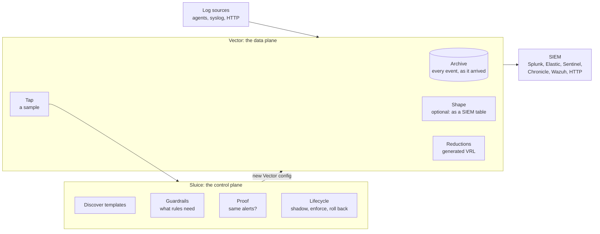

# How Sluice works, and what it is built on

This page is for people who want to understand Sluice before they run it, review it or
contribute to it. It explains the moving parts, how an event travels through them, and which
technologies each part uses and why. The decisions behind each choice are in [the ADRs](adr/);
verified facts about third-party tools are in [the notes](notes/).

## The idea in one picture

Sluice sits between your log sources and your SIEM. [Vector](https://vector.dev) moves the data;
Sluice decides what Vector does with it, and proves every decision before it takes effect.

The order inside Vector is fixed: **archive first**, then shape, then the tap and the cuts. So
whatever Sluice decides, the original event is always kept (safety contract rule 2).

## What happens to your data

1. **Archive.** Vector writes every event to a gzip NDJSON archive, per source and UTC hour,
   before anything else touches it. `sluice search` and `sluice replay` read it back.
2. **Shape (optional).** Some SIEM tables expect a fixed record shape (Microsoft Sentinel's
   `SecurityEvent`, `Syslog`, `CommonSecurityLog`, the ASIM tables). A source with `shape:` turns
   its events into that shape here, after the archive.
3. **Tap.** A sample of the (shaped) events goes to the control plane over HTTP.
4. **Discover.** Sluice groups events into *templates*: for JSON, by source, a few
   discriminator fields (such as `EventID`) and the set of fields present; for text, with the
   Drain algorithm. A template is a kind of event, such as "Windows logon, type 3".
5. **Propose.** For each template, community *recipes* (YAML in [`recipes/`](../recipes/))
   propose reductions: drop format fat (rendered messages, empty fields, redundant XML), forward
   only what rules could match and count the rest in summaries. An optional AI advisor proposes
   recipes for templates no recipe covers.
6. **Guard.** The guardrails narrow every proposal to what the loaded detection rules allow:
   a field any applicable rule reads is kept, events a rule could match are forwarded whole, rare
   templates are never cut. Rules come from Sigma, Wazuh and Microsoft Sentinel; each is read
   into the same engine-neutral *requirements* (log source, fields, pre-filter, statefulness).
   Anything Sluice cannot understand counts as "may read everything".
7. **Prove.** Sluice runs the rules on the sample twice, on the full events and on the events
   as the reductions would forward them, and compares the alerts. Only the same alerts count as
   proof. The reductions it runs are the exact VRL that Vector will run.
8. **Lifecycle.** A recipe that holds goes into *shadow*. After it has held long enough, it is
   *enforced*: Sluice writes a new Vector configuration and reloads Vector. Every cycle proves
   everything again; a recipe that fails is rolled back on the spot.

Each destination may run its own rules (`sluice_rules`). Sluice then keeps a separate proof,
lifecycle and pipeline per *rule profile*, so a Sentinel destination is not held back by Wazuh
rules that only the Wazuh destination runs (ADR 0012).

## The parts

Sluice is a Rust workspace with one crate per responsibility. Dependencies point inward, toward
`sluice-core`, which has no I/O and no third-party engines.

| Crate | Responsibility |
|---|---|
| `sluice-core` | The domain model, the safety contract, the guardrails and the shadow proof. Pure logic. |
| `sluice-discover` | Template discovery: keysets for JSON, Drain for text. |
| `sluice-rules` | Reads Sigma, Wazuh and Sentinel rules into requirements; evaluates Sigma for the proof. |
| `sluice-vector` | Compiles recipes to VRL and Vector configuration, runs that VRL for the proof, and shapes events into SIEM tables. |
| `sluice-kql` | KQL for Sentinel: pre-filters as DCR transformations, and analytics rules run in the Kusto emulator for the proof. |
| `sluice-autopilot` | Puts it together: discover, resolve recipes, guard, prove, emit the data plane, lifecycle. |
| `sluice-server` | The control plane of `sluice up`: tap ingest, control loop, status API, web console, Vector supervision. |
| `sluice-archive` | Search and replay over the archive. |
| `sluice-mcp` | An MCP server, so AI assistants can ask what was cut and why. |
| `sluice-ai` | The optional AI advisor for recipes. |
| `sluice-wazuh` | Exact rule checks through a Wazuh manager's `logtest` API. |
| `sluice-synth` | Deterministic synthetic security logs for the demo and the tests. |
| `sluice-cli` | The `sluice` command: arguments, files, exit codes, logging. |

## Technologies

### Language and build

| Technology | What Sluice uses it for | Why |
|---|---|---|
| [Rust](https://www.rust-lang.org) 1.99 (edition 2024) | All of Sluice | The proof can run the very VRL that Vector enforces, through the `vrl` crate, in the same process; one static binary; no unsafe code (ADR 0001). |
| [Cargo](https://doc.rust-lang.org/cargo/) workspace | One crate per responsibility | Keeps third-party engines behind Sluice's own traits, so young dependencies stay replaceable. |
| musl + [cargo-zigbuild](https://github.com/rust-cross/cargo-zigbuild) | Static release binaries for x86_64 and aarch64 | Run on any Linux distribution without a matching libc (ADR 0007). |
| [cargo-deny](https://github.com/EmbarkStudios/cargo-deny) | License and advisory checks on every dependency | Part of the quality gates. |

### The data plane

| Technology | What Sluice uses it for | Why |
|---|---|---|
| [Vector](https://vector.dev) 0.59 (MPL-2.0) | Receiving, archiving, shaping, reducing and sending every event | Fast, widely used, with sinks for every major SIEM, and its transform language is embeddable. |
| [VRL](https://vector.dev/docs/reference/vrl/) through the `vrl` crate 0.36.0 | The reductions and shapes Sluice generates | The same compiler and runtime as Vector 0.59, so what Sluice proves is what Vector runs ([compatibility](compatibility.md)). Generated VRL must compile without warnings. |
| Vector's `windows_event_log` source | Collecting Windows events on hosts (`sluice agent windows`) | An open-source agent instead of the Azure Monitor Agent, with Sluice in control of what is collected (ADR 0014). |

### Rules and engines

| Technology | What Sluice uses it for | Why |
|---|---|---|
| [Sigma](https://sigmahq.io) rules, via [rsigma](https://crates.io/crates/rsigma-parser) 0.24 | Parsing and evaluating Sigma rules, including correlations, for the proof | Sigma is the shared rule language most SIEMs can import. Pinned and kept behind Sluice's own trait. |
| Wazuh `rules.xml` and decoders, via quick-xml | Reading Wazuh's own rules into requirements | Wazuh users keep their real detections; an optional live `logtest` check confirms them on the manager. |
| Microsoft Sentinel analytics rules (KQL) | Reading the rules a Sentinel workspace runs, including ASIM parsers, into requirements | Sentinel's detections are KQL, not Sigma (ADR 0015). |
| [Kusto emulator](https://learn.microsoft.com/azure/data-explorer/kusto-emulator-overview) (Docker) | Running Sentinel's analytics rules themselves on full and forwarded records | The proof for a Sentinel destination is decided by Microsoft's engine and Microsoft's rules. |
| Drain (implemented in Sluice) | Template discovery for text logs | A well-studied online log parser; small enough to own ([notes](notes/drain.md)). |

### The control plane

| Technology | What Sluice uses it for | Why |
|---|---|---|
| [tokio](https://tokio.rs) and [axum](https://github.com/tokio-rs/axum) | The control plane's HTTP API, tap ingest and Vector supervision | Mature async Rust stack. |
| A web console built into the binary | Status, templates, proofs, guardrail reasons, archive search | No external assets; strict Content Security Policy (ADR 0011). |
| [MCP](https://modelcontextprotocol.io) via rmcp 3.5 | Letting AI assistants query status and the archive | Over stdio or HTTP with a mandatory bearer token ([notes](notes/mcp.md)). |
| gzip NDJSON (flate2) | The archive | Plain files any tool can read; streaming search without a database (ADR 0006). |
| Vector secret backends | SIEM credentials | Credentials stay in files, never in the configuration (ADR 0010). |

### SIEM integration

| Technology | What Sluice uses it for |
|---|---|
| Splunk HEC, Elasticsearch, Google SecOps, Wazuh, plain HTTP | Destinations, printed by `sluice connect` and validated against Vector. |
| Azure Monitor Logs Ingestion API and data collection rules | Sending to Microsoft Sentinel: standard tables (`SecurityEvent`, `WindowsEvent`, `Syslog`, `CommonSecurityLog`, `ASimNetworkSessionLogs`, `ASimDnsActivityLogs`) or a custom `_CL` table derived from a sample. Verified in a real workspace ([notes](notes/sentinel-dcr.md)). |

### AI (optional)

| Technology | What Sluice uses it for |
|---|---|
| Anthropic Claude, or any OpenAI-compatible API (Ollama, LM Studio) | Proposing recipes for templates no community recipe covers. Samples are redacted first, the answer must fit a narrow schema, and the guardrails and the proof decide as for any other recipe. AI proposes; it never decides ([notes](notes/ai.md)). |

### Packaging and deployment

| Technology | What Sluice uses it for |
|---|---|
| Docker image | Sluice together with the Vector release it is verified against, on Vector's distroless image. |
| Docker Compose | A complete local stack with demo traffic (`examples/docker`). |
| Helm | Running Sluice on Kubernetes (`deploy/helm/sluice`). |

## How Sluice checks itself

Every engine Sluice generates code for gets a test against the real engine:

- **Vector:** `scripts/vector-check.sh` runs `vector validate` and `vector test` on a generated
  configuration, so the real binary must reproduce what the `vrl` crate computed.
- **Kusto:** `scripts/kql-check.sh` runs generated KQL and Sentinel rules in the Kusto emulator.
- **Sigma:** a differential test against pySigma over all SigmaHQ rules.
- **Wazuh:** findings checked with a live manager's `logtest` ([notes](notes/wazuh.md)).
- **Azure:** table shapes and data collection rules checked by sending records into a real
  workspace.

Property tests cover the central claim: for all inputs, the alerts over the forwarded data equal
the alerts over the full data. `scripts/check.sh` runs every gate; CI runs the same.
