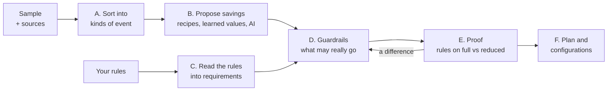

# How Sluice saves

This page explains the algorithm: first the whole picture in a paragraph, then the steps, then
each way of saving two or three levels deep. It assumes you know what a SIEM, a log event and a
detection rule are, and nothing about Sluice. The reasoning behind *why* each saving is safe is in
the [field theory](notes/field-theory.md); the decisions are in the [ADRs](adr/).

## In one paragraph

Sluice takes a sample of your logs (say an hour) and the detection rules your SIEM runs. It sorts
the events into kinds, works out for each kind which fields any rule could ever read and which
events any rule could ever match, and proposes to send less of everything else: text that only
repeats the event, empty fields, values that follow from other values, and whole events no rule
can see, which it counts instead. Then it runs your rules on the full sample and on the reduced
one, and keeps only savings for which both give exactly the same alerts. What is left becomes a
plan and the configurations that carry it out (Vector, or your SIEM's own ingestion). The
originals are always archived, so nothing is lost, only moved to cheaper storage.

## The steps



| Step | In one line | Where to read more |
|---|---|---|
| A. Kinds of event | Group events so every decision is made once per kind, not per event. | [Sorting](#1-sorting-events-into-kinds) |
| B. Proposals | Recipes, values learned from the sample, and optionally an AI say what *could* go. | [The savings](#3-the-savings) |
| C. Requirements | Every rule becomes: which events can it match, which fields does it read. | [Reading the rules](#2-reading-the-rules) |
| D. Guardrails | Each proposal is cut down to what no rule could notice. | [Guardrails](#4-the-guardrails) |
| E. Proof | The rules run twice; any difference rolls a saving back. | [The proof](#5-the-proof) |
| F. Output | `plan.json`, `report.html`, `vector.yaml`, native configurations. | [Where it runs](#6-where-the-saving-runs) |

## 1. Sorting events into kinds

Every decision Sluice makes is per *template*: one kind of event in one source, such as "Windows
Security 4624, logon" or "the firewall's pass lines". That is what makes the analysis fast (a
few hundred kinds instead of millions of events) and what makes a saving explainable ("on this
kind of event, this field goes, because...").

**JSON events.** The kind is named by a few fields that say what the event is: `EventID`,
`event.code`, `event.action`, `action`, known ones for products such as CloudTrail, or the
source's own `event_type`. Within one EventID, Sluice also looks at which fields are present
(the *key set*): a frequent key set is a *variant* of the kind, a rare one becomes a kind of its
own.

- *Why the key set matters.* "Absent" must mean something. If a field is in every variant of a
  kind and Sluice removes it, a missing field can only mean Sluice removed it, so it can be put
  back without guessing ([implied values](#33-implied-values)).
- *Why rare key sets get their own kind.* Rare kinds are never saved on (below), so an odd event
  is not hidden inside a frequent kind and reduced with it.

**Text lines** (syslog, `auth.log`) have no fields, so Sluice clusters them with Drain, a
well-known online log parser ([notes](notes/drain.md)): lines that share their words except for
a few changing ones (numbers, IDs, user names) form one template.

- Numbers and hex IDs are masked first, and the syslog header is reduced to the program name, so
  `sshd[1234]` and `sshd[5678]` are one program.
- Where only a few words alternate, the template is split: `Accepted password` and `Failed
  password` stay apart, since a rule cares about exactly that difference.

**Rare kinds are untouchable.** A kind with fewer than 100 events, or under 0.1 % of its source,
is sent as it is (contract rule 4). Attacks are often rare events, and a sample says little about
a kind it has seen a handful of times.

## 2. Reading the rules

Sluice reads every rule into the same small description, a *requirement*, whatever the language:
Sigma, Wazuh XML, Sentinel KQL, Elastic KQL, EQL or ES|QL.

| Part | What it says | Example |
|---|---|---|
| Log source | Which sources the rule applies to | `windows / sysmon` |
| Fields read | Every field the rule reads, also in exclusions | `TargetImage`, `GrantedAccess`, `SourceImage` |
| Pre-filter | A test that is true for *at least* every event the rule could match | `EventID = 10 and TargetImage ends with lsass.exe` |
| Raw text | Whether it searches the whole event as text | a keyword rule `mimikatz` |
| State | Whether it counts or correlates events | "more than 10 failed logons in 5 minutes" |

**The pre-filter is a superset, on purpose.** Sluice never needs to know exactly what a rule
matches, only what it *certainly does not* match. Everything that is hard to reason about is
widened:

- A `not`, a `null` test or an `exists: false` becomes "every event". So a rule that fires when a
  field is *missing* protects that field everywhere, and removing a field can never make a
  quiet rule fire.
- A regular expression, a value matched by meaning (a network range, a number written in another
  form) or a function Sluice cannot read becomes "the field has a value" or "every event".
- Anything Sluice cannot read at all becomes "reads every field, of every event" and is listed in
  the report under problems: it costs savings, never a detection.

**The kind of event rules most rules out.** A kind's fixed values (its EventID, its provider) are
tested against each rule's pre-filter. A rule for failed logons (`EventID = 4625`) can never match
a successful logon (4624), so on 4624 it protects nothing. With thousands of SigmaHQ rules, each
kind of event is usually in reach of only a few of them.

**Field names must agree.** A Sigma rule says `Image`; Elastic's ECS calls the same thing
`process.executable`. If a source's names differ from the rule's, the rule cannot be compared
field by field, so it is read as reading everything there (ADR 0018), unless you load the
mapping your SIEM converts Sigma with (`--sigma-pipeline`).

## 3. The savings

Each saving below says what goes, why that loses nothing, and how deep the trick goes.

### 3.1 Text that repeats the event

The largest single saving on Windows. A Windows event carries its data twice: once as fields
(`TargetUserName`, `LogonType`, ...) and once as `Message`, a sentence Windows builds from a fixed
template per EventID with those same values filled in ("An account was successfully logged
on... Account Name: alice..."). `Message` is 26 to 44 % of the bytes of a Windows log.

- *Why it is safe.* `Message` adds no information beyond the fields: given the other fields, it
  can always be built again. Measured on real data: with the varying values masked, events
  whose other fields agree carry the same message, for 92 % of the message bytes on a PC's System
  log and 72 to 81 % on APT29 ([field theory](notes/field-theory.md)). The rest is where Windows
  renders a value differently (`%%1842` becomes "Yes"), not new information.
- *What if a rule reads `Message`?* Then it stays on the events that rule could match (section 4).
- *Same idea, other places:* Sentinel's `EventData` column repeats the named fields as XML (a
  recipe removes it for 4672 and 4798, where every item has its own column), and a parsed
  firewall line repeats its own `message`.

These come from **recipes**: small YAML files per product and kind of event, written once and
shared (`recipes/`). A recipe names the kind it applies to, the reduction, and why:

```yaml
id: microsoft/windows/security/rendered-message
match:
  logsource: { product: windows, service: security }
reductions:
  - op: drop_fields
    fields: [Message]
  - op: drop_empty_fields
rationale: >-
  Message is the localized rendering of the event's own EventData fields plus fixed text.
```

A recipe is only a proposal: the guardrails and the proof decide.

### 3.2 Empty fields and empty objects

A field holding `null`, `""` or `{}` says nothing, but a SIEM bills its name every time. Recipes
remove them; a rule that tests for an empty value keeps them. When the removals take every field
out of a nested object, the leftover `{}` goes too (ADR 0033), except an object that arrived
empty, since that may mean something.

### 3.3 Implied values

Values that follow from other values. Sluice learns these from your own sample; no recipe is
needed.

**Level 1: what.** On every Windows Security event, `Channel` is `Security`, and `Keywords` is
`0x8020000000000000` on successful audits. On a 4624 logon, `RestrictedAdminMode` is `-` unless
the logon type is 10 (remote desktop). Sending those values millions of times tells the SIEM
nothing it could not know.

**Level 2: how.** Per kind of event, per field, Sluice looks for a rule `value = f(context)`:

- by the kind alone: "on this kind, `Keywords` is `0x8020...`";
- or by one other field: "when `LogonType` is 2 or 3, `RestrictedAdminMode` is `-`".

It removes the field **only from an event where it holds exactly that value** (the *value
guard*), and the plan lists every rule (`remove_implied`), so any tool can put it back:
`<Table>Full` in Sentinel and runtime fields in Elasticsearch read the table as if nothing was
removed.

**Level 3: the tricks and the limits.**

- *Lossless whatever happens later.* Because of the value guard, an event with any other value
  keeps its own. So the rule may even be wrong on new data: then it simply saves less. This is
  why Sluice also learns a value that holds on **nine in ten** events, not only on all of them.
  Learned on APT29's first day and applied to the next day's attack, the nine-in-ten values kept
  their saving (Security: 34.0 % of the bytes, against 29.7 % for exact ones only).
- *What may imply.* The other field must behave like a category: 2 to 32 distinct values, at
  least 20 events per value, and no values that only appear late in the sample (an identifier
  keeps bringing new ones). A field that implies another is never removed itself, or the other
  could not be put back.
- *What may not be implied.* Identifiers (names ending in `Id` or `Guid`: a logon session, a
  process) are only implied by the kind of event, never by another field: one machine kept the
  same thread through the sample, the next restart changes it. IP addresses and ports are never
  implied at all: in a lab they look constant, and an attack is exactly a new address.
- *One machine's sample.* A value that is the same on every kind of event, such as the computer's
  name, may belong to the machine rather than to the kind. The report lists these per source
  ("check these"), so you can see what would change on other machines.

### 3.4 Counting instead of sending

The biggest lever on high-volume kinds of event. Most process-access events (Sysmon 10) are
routine handle activity between system processes; a rule only cares about a few, such as
something opening LSASS with full access.

**Level 1: what.** For such a kind, a recipe says `forward_matching`: send whole every event a
rule could match, and count the rest.

**Level 2: how.** The events any applicable rule could match are exactly those its pre-filter
matches (section 2). Every event outside all of them is replaced by a count: one *summary record*
per minute per combination of the recipe's summary keys (for process access: source program,
target program and access mask), saying "this happened 812 times". On OTRF's APT29 data, 39,278
of 39,283 process-access events become 2,489 summary records; the 5 a credential-dumping rule
could match are sent whole.

**Level 3: the conditions.**

- *Only with every rule.* A rule Sluice was not given could match what it counts. So counting
  happens only when the rules are known to be complete: fetched from the SIEM with `sluice rules
  fetch`, which records that the inventory is whole, or declared with `--rules-complete`.
- *Stateful rules.* A rule that counts ("more than 10 in 5 minutes") has a pre-filter covering
  every event it counts, so those all stay.
- *Honest bytes.* The summary records are sent too, so they count against the saving: a kind
  that is counted saves what its events took, minus what their counts take.
- *Kinds no rule sees at all* can be counted entirely (L3).

### 3.5 Keeping a field only where a rule could look (conditional protection)

What makes the savings above large with thousands of rules. A rule reads `CommandLine`; does that
mean `CommandLine` can never go? No: the rule only reads it on events it could match. So Sluice
keeps the field whole on exactly those events (`keep_whole_when` in the plan: the union of the
protecting rules' pre-filters) and removes it everywhere else. Removing a field from an event
outside the pre-filter cannot make that rule fire: its pre-filter was already false there, and
removing fields only makes its remaining tests harder to pass (the widening in section 2).

### 3.6 The cheaper table (routing to the archive)

Everything above sends less to the SIEM's expensive table. Nothing is thrown away: Vector writes
every event to an archive as it arrived, and the data collection rule Sluice writes for Sentinel
has a second flow that puts every record, untouched, into a table on the Auxiliary plan. In West
Europe a GB costs $5.59 in Sentinel's analytics table and about $0.20 in the data lake, so a byte
moved there costs about 3.5 % of what it did and stays searchable.

Sentinel's ingestion cannot count, so there Sluice does the next best thing (ADR 0036): an event
Vector would count stays out of the analytics table and lives in the archive table only. On
APT29, keeping every event searchable this way costs 2 to 4 points of the saving (75.7 % instead
of 78.1 % less, priced with `scripts/research/tiers.py`).

## 4. The guardrails

Every proposal, from a recipe, a learned value or an AI, goes through the same function
(`guard`), which returns what may actually be done and a recorded reason for every cut. In order
of how often they bite:

1. **A field a rule may read stays on every event that rule could match** (contract rule 3), and
   an event a rule could match is sent whole when counting.
2. **Rare kinds are untouched** (rule 4), and so is an event that fits no kind (rule 1).
3. **No counting without every rule** (the inventory is complete, or you say so).
4. **A rule that searches the whole event as text** (a Wazuh rule on the full log, a Sigma
   keyword) protects every field of a JSON event, since a word may appear in any value.
5. **A rule written in other field names** reads everything there (section 2).
6. **Unknown means everything.** Whatever Sluice cannot read in a rule widens it; it never
   narrows it.

The report lists each cut with the rule that caused it ("Image kept on events “PsExec Remote
Execution” could match"), so you see what your rules cost and what a fix would save.

## 5. The proof

The guardrails are reasoning; the proof is evidence. Sluice runs your rules twice on the sample:
on the events as they are, and on the events as the configuration would send them, computed with
the same code Vector runs (the `vrl` crate). Sigma rules run in rsigma; with `--kusto`, Sentinel's
rules run in the Kusto emulator (Microsoft's own engine); with `--elasticsearch`, Elastic's in
Elasticsearch.

- **Same alerts, both ways.** Not just as many: the same rule on the same event. An alert that
  disappears and one that appears both fail the proof.
- **Rollback.** A saving involved in a difference is undone, and the proof runs again until it
  holds.
- **Bytes counted as sent.** What the SIEM would still receive, summary records included; that is
  the number in the report.
- **An empty proof says so.** A sample that raises no alert shows nothing about detections; the
  report and `sluice prove` say this instead of a green tick.

## 6. Where the saving runs

The plan (`plan.json`) is engine-neutral. Sluice turns it into configurations and proves each in
its own engine before writing it:

| Target | What it can do | How it recognises a kind of event |
|---|---|---|
| Vector (`vector.yaml`) | Everything: removals, implied values, counting, the archive | The generated VRL program, the same code the proof ran |
| Sentinel data collection rule | Removals and implied values per column; routing to the archive table | A signature: one bit per column (empty or not), plus the kind's fixed values |
| Elasticsearch ingest pipeline | Removals and implied values | The kind's fixed values and its exact set of fields, in Painless |
| Fluent Bit, OpenTelemetry Collector | Removals and implied values in the agent | The same, in Lua and OTTL |

Two rules hold for every target: **never more than Vector** (each target is checked to remove
nothing the proven Vector program keeps) and **when unsure, send it as it is** (a record that
fits no kind, or that two kinds could claim, is left alone).

## Following one event

A Sysmon event 10 from APT29 in which a process opens `lsass.exe` with full access: one of the
five the example rule `LSASS Opened With Full Access` (`examples/apt29/rules`) could match.

1. **Kind:** Sysmon, `EventID` 10, the usual key set. A frequent kind (39,283 events), so it may
   be saved on.
2. **Proposals:** the process-access recipe says "count what no rule could match", the
   rendered-message recipe says "drop `Message`", and the learner proposes implied values for the
   kind (`Channel`, `Opcode`, ...).
3. **Rules:** that rule applies (Sysmon, process access). Its pre-filter is roughly `EventID 10
   and TargetImage ends with lsass.exe and GrantedAccess in (0x1fffff, ...)`: its exclusion of
   `wininit` and `csrss` is a `not`, which the pre-filter widens away. It reads `TargetImage`,
   `GrantedAccess` and `SourceImage`.
4. **Guardrails:** this event matches the pre-filter, so it is sent, not counted, and whole:
   every field the rule reads stays. Its 39,278 siblings that match no pre-filter are counted.
5. **Proof:** the rule fires on this event in the full sample and in the reduced one: same alert.
6. **Result:** the SIEM gets this event and four others like it in full, and 2,489 summary
   records for the rest; the archive has all 39,283 as they came.
